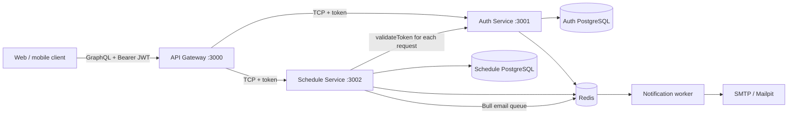

# Healthcare Schedule System

Backend microservices for healthcare appointment scheduling. The API gateway exposes GraphQL, while the Auth and Schedule services communicate over NestJS TCP. Each service owns a PostgreSQL database. Redis supports Auth rate limiting, Schedule query caching, Bull email jobs, and scheduled in-app reminders.

## Architecture



The gateway extracts the `Authorization: Bearer <token>` header and passes the token with each Schedule RPC command. Schedule Service asks Auth Service to validate it before executing the operation. Invalid or missing tokens are rejected as Unauthorized. Redis stores short-lived query results, throttling counters, Bull email jobs, and reminder due times. In-app reminders are also persisted in Schedule PostgreSQL so they can be recovered if Redis is unavailable.

## Run with Docker Compose

Requirements: Docker with Compose and Node.js 20+ with Yarn.

1. Copy `.env.example` to `.env`. Replace the example database/Redis passwords and `JWT_SECRET` for your environment. Keep Redis URL credentials URL-encoded if they contain reserved characters.
2. Start the containers:

   ```bash
   docker compose up --build -d
   ```

3. Install dependencies and apply the Prisma migrations from the host:

   ```bash
   yarn install
   yarn db:deploy:auth
   yarn db:deploy:schedule
   ```

4. Open GraphQL Playground at <http://localhost:3000/graphql>. In development, Playground and schema introspection are enabled. Use the `Headers` panel for authenticated operations:

   ```json
   { "Authorization": "Bearer <access-token>" }
   ```

Email is captured locally by Mailpit at <http://localhost:8025>. To use a real mail provider, set `SMTP_HOST`, `SMTP_PORT`, `SMTP_SECURE`, `SMTP_USER`, `SMTP_PASSWORD`, and `SMTP_FROM` in `.env`, then restart the notification worker. Check container health/logs with `docker compose ps` and `docker compose logs -f auth-service schedule-service notification-service`.

## Environment variables

| Variable                                                                                              | Purpose                                                                                     |
| ----------------------------------------------------------------------------------------------------- | ------------------------------------------------------------------------------------------- |
| `NODE_ENV`                                                                                            | Runtime mode; Compose services run in production mode.                                      |
| `GRAPHQL_PLAYGROUND_ENABLED`                                                                          | Enables Playground in the Compose gateway (default: `true` for this local setup). Disable in production deployments. |
| `API_GATEWAY_PORT`, `API_GATEWAY_HOST_PORT`                                                           | Gateway container and host ports.                                                           |
| `AUTH_SERVICE_PORT`, `AUTH_SERVICE_HOST`                                                              | Auth TCP port and optional host development address. In Compose, service DNS is used.       |
| `SCHEDULE_SERVICE_PORT`, `SCHEDULE_SERVICE_HOST`                                                      | Schedule TCP port and optional host development address. In Compose, service DNS is used.   |
| `AUTH_DB_USER`, `AUTH_DB_PASSWORD`, `AUTH_DB_NAME`, `AUTH_DB_HOST_PORT`                               | Auth PostgreSQL container credentials/database and published port.                          |
| `AUTH_DATABASE_URL`, `AUTH_DATABASE_URL_LOCAL`                                                        | Auth Prisma URL for Docker and optional host development.                                   |
| `SCHEDULE_DB_USER`, `SCHEDULE_DB_PASSWORD`, `SCHEDULE_DB_NAME`, `SCHEDULE_DB_HOST_PORT`               | Schedule PostgreSQL container credentials/database and published port.                      |
| `SCHEDULE_DATABASE_URL`, `SCHEDULE_DATABASE_URL_LOCAL`                                                | Schedule Prisma URL for Docker and optional host development.                               |
| `JWT_SECRET`                                                                                          | Secret used to sign and verify access tokens. Use a strong private value.                   |
| `REDIS_PASSWORD`, `REDIS_HOST_PORT`                                                                   | Redis container password and published port.                                                |
| `REDIS_URL`, `REDIS_URL_LOCAL`                                                                        | Redis URL for containers and optional host development.                                     |
| `AUTH_LOGIN_RATE_LIMIT`, `AUTH_LOGIN_RATE_WINDOW_SECONDS`                                             | Login attempts per normalized email and rate window (defaults: 5 per 900 seconds).          |
| `AUTH_REGISTER_RATE_LIMIT`, `AUTH_REGISTER_RATE_WINDOW_SECONDS`                                       | Registration attempts per normalized email and rate window (defaults: 10 per 3600 seconds). |
| `QUERY_CACHE_TTL_SECONDS`                                                                             | Schedule query cache lifetime (default: 30 seconds).                                        |
| `SMTP_HOST`, `SMTP_HOST_LOCAL`, `SMTP_PORT`, `SMTP_SECURE`, `SMTP_USER`, `SMTP_PASSWORD`, `SMTP_FROM` | Outbound email transport settings. Defaults point at Mailpit for local development.         |
| `MAILPIT_WEB_PORT`                                                                                    | Mailpit web UI host port (default: 8025).                                                   |
| `OBSERVE_APP_KEY`, `OBSERVE_APP_SECRET`                                                               | Optional NestJS Observe credentials for service telemetry.                                  |

The `.env.example` values are for local development only. For a host-run Nest process, use the `*_LOCAL` database and Redis URLs where provided; Compose uses the container URLs.

## GraphQL examples

All operations are documented in Playground's Docs panel. Register and log in without a token first:

```graphql
mutation Register {
  register(
    email: "customer@example.com"
    password: "StrongPass123"
    name: "Amani"
  ) {
    id
    email
    name
  }
}
```

```graphql
mutation Login {
  login(email: "customer@example.com", password: "StrongPass123") {
    accessToken
    tokenType
    expiresIn
    user {
      id
      email
      name
    }
  }
}
```

Copy `accessToken` into the `Authorization` header described above. Schedule Service validates it with Auth Service on each operation.

```graphql
mutation BookAppointment {
  createSchedule(
    objective: "Konsultasi"
    doctorId: "<doctor-uuid>"
    scheduledAt: "2026-11-05T09:00:00.000Z"
  ) {
    id
    status
    scheduledAt
    doctor {
      id
      name
    }
    customer {
      id
      name
      email
    }
  }
}
```

The customer and doctor must exist and the selected time must fit the doctor's availability. Booking queues a confirmation email and creates in-app reminders for 24 hours and 1 hour before the appointment.

```graphql
query MyNotifications {
  notifications(page: 1, limit: 20) {
    items {
      id
      title
      message
      readAt
      createdAt
    }
    page
    total
  }
}
```

Clinic admins can also manage a workflow sequence. Steps are stored in the Schedule database per admin account; save replaces the complete ordered list.

Customer profiles include optional phone, gender, birth date, address, treatment, treatment status, next visit, and note fields. Apply the Schedule database migrations before using these profile fields:

```sh
yarn db:deploy:schedule
```

Admin users can create, update, and delete customers and doctors. Doctor accounts can be linked with `userId`; admins and the linked doctor can maintain weekly availability. `doctorAvailabilities(doctorId)` returns configured windows (UTC), while `availableSlots(doctorId, date)` returns future unbooked slots for a UTC date.

```graphql
query WorkflowSteps {
  workflowSteps {
    id
    title
    description
    position
  }
}
```

```graphql
mutation SaveWorkflow {
  saveWorkflowSteps(
    steps: [
      { title: "Registrasi", description: "Verifikasi data pasien" }
      { title: "Pemeriksaan", description: "Pemeriksaan oleh dokter" }
    ]
  ) {
    id
    title
    description
    position
  }
}
```

```graphql
mutation MarkNotificationRead {
  markNotificationRead(id: "<notification-uuid>")
}
```

```graphql
mutation DeleteSchedule {
  deleteSchedule(id: "<schedule-uuid>")
}
```

Schedule deletion is restricted to administrators and queues a customer email. Other useful operations include `customers`, `customer`, `doctors`, `doctor`, `schedules`, `schedule`, `availableSlots`, `setDoctorAvailability`, `updateScheduleStatus`, and `reschedule`; use the Playground Docs panel for argument and role descriptions.

## Roles and appointment behavior

- Registration creates a `CUSTOMER` account. To bootstrap the first administrator, register the account and promote it directly in the Auth database:

  ```sql
  UPDATE "User" SET "role" = 'ADMIN' WHERE "email" = 'admin@example.com';
  ```

- Admins can assign roles with `setUserRole`. Configure a doctor's account as `DOCTOR` before linking it to a doctor profile.
- Doctors (or admins) configure weekly availability with `setDoctorAvailability`. `dayOfWeek` is `0` Sunday through `6` Saturday; hours and appointment timestamps use UTC. Slots must be 5–240 minutes and evenly divide the time range.
- `availableSlots(doctorId, date)` lists future openings. A database constraint prevents overlapping appointments, including concurrent bookings.
- Customers can book and view their own appointments, cancel with at least 24 hours' notice, and reschedule appointments in `REQUESTED` status. Doctors can view their own appointments and confirm, cancel, or complete them. Admins can manage directory data and delete schedules.
- Appointment state flow: `REQUESTED` → `CONFIRMED` → `COMPLETED`; active appointments can be cancelled.
- The GraphQL `notifications` and `markNotificationRead` operations provide the backend API for the existing frontend notification UI. The frontend should query/poll notifications and mark them read; this repository contains backend services only.

## Build, migrations, and coverage

```bash
yarn build
yarn build:auth
yarn build:schedule
yarn build:notification
yarn test
yarn test:cov
```

Coverage thresholds are configured at 50% for the tracked application and shared core modules. Apply development migrations with `yarn db:migrate:auth` and `yarn db:migrate:schedule`; use `yarn db:deploy:auth` and `yarn db:deploy:schedule` in deployment environments.
