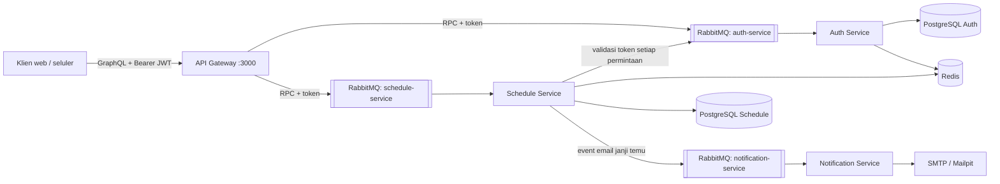

# Backend Rata Healthcare

Backend ini mengatur janji temu layanan kesehatan lewat beberapa service. Frontend mengakses GraphQL dari API Gateway. Auth Service dan Schedule Service saling kirim request lewat RabbitMQ, dan Schedule Service juga mengantrekan email ke Notification Service. Tiap service punya database PostgreSQL sendiri. Redis dipakai untuk membatasi percobaan login, menyimpan cache jadwal, dan mengatur pengingat di aplikasi.

## Arsitektur



Gateway mengambil token dari header `Authorization: Bearer <token>`, lalu meneruskannya ke Schedule Service. Sebelum memproses permintaan, Schedule Service mengecek token ke Auth Service. Kalau tokennya tidak valid atau tidak ada, permintaan akan ditolak. RabbitMQ menangani komunikasi antar-service dan antrean email. Redis menyimpan cache, hitungan percobaan login, dan waktu pengingat. Data pengingat juga tetap tersimpan di PostgreSQL Schedule, jadi bisa dipulihkan kalau Redis sedang tidak tersedia.

Kalau email gagal terkirim, Notification Service akan mencoba lagi sampai lima kali, dengan jeda 5, 10, 20, 40, lalu 80 detik. Kalau tetap gagal, pesannya masuk ke antrean `notification-service.dead-letter` supaya bisa dicek atau dicoba kirim ulang lewat RabbitMQ Management UI. Email yang berhasil terkirim akan dikonfirmasi ke broker.

## Menjalankan dengan Docker Compose

Yang perlu disiapkan: Docker Compose, Node.js 20+, dan Yarn.

1. Salin `.env.example` jadi `.env`. Ganti password database/Redis dan contoh `JWT_SECRET` dengan nilai lokalmu. Kalau password Redis punya karakter khusus, encode dulu sebelum dipakai di URL.
2. Jalankan semua container:

   ```bash
   docker compose up --build -d
   ```

   RabbitMQ Management UI tersedia di <http://localhost:15672> dengan kredensial `RABBITMQ_USER` dan `RABBITMQ_PASSWORD` dari `.env` (default lokal: `healthcare` / `healthcare-local`). Koneksi AMQP lokal menggunakan port `5672`.

3. Di komputer host, pasang dependensi lalu jalankan migrasi Prisma:

   ```bash
   yarn install
   yarn db:deploy:auth
   yarn db:deploy:schedule
   yarn seed:demo-admin
   ```

   Perintah seed ini menyiapkan atau memperbarui akun admin lokal untuk demo teknis. Kamu bisa masuk dengan `admin@rata.test` / `RataDemo!2026`. Seed hanya berjalan kalau database-nya ada di localhost.

4. Buka GraphQL Playground di <http://localhost:3000/graphql>. Untuk konfigurasi lokal ini, Playground dan schema introspection sudah aktif. Kalau operasinya butuh login, isi bagian `Headers` seperti ini:

   ```json
   { "Authorization": "Bearer <access-token>" }
   ```

Email yang dikirim saat development lokal bisa kamu lihat di Mailpit: <http://localhost:8025>. Kalau mau memakai layanan email sungguhan, atur `SMTP_HOST`, `SMTP_PORT`, `SMTP_SECURE`, `SMTP_USER`, `SMTP_PASSWORD`, dan `SMTP_FROM` di `.env`, lalu restart worker notifikasi. Cek status container dan log dengan `docker compose ps` serta `docker compose logs -f auth-service schedule-service notification-service`.

## Variabel lingkungan

| Variabel | Kegunaan |
| --- | --- |
| `NODE_ENV` | Mode aplikasi. Service Compose berjalan dalam mode production. |
| `GRAPHQL_PLAYGROUND_ENABLED` | Mengaktifkan Playground pada gateway Compose (default `true` untuk konfigurasi lokal ini). Nonaktifkan untuk deployment production. |
| `API_GATEWAY_PORT`, `API_GATEWAY_HOST_PORT` | Port gateway di dalam container dan port yang dibuka di host. |
| `RABBITMQ_USER`, `RABBITMQ_PASSWORD` | Kredensial broker RabbitMQ lokal. |
| `RABBITMQ_HOST_PORT`, `RABBITMQ_MANAGEMENT_HOST_PORT` | Port AMQP dan port Management UI yang dibuka di host (default: 5672 dan 15672). |
| `RABBITMQ_URL` | URL broker RabbitMQ untuk menjalankan service langsung dari host. Compose mengatur URL internal ke `rabbitmq:5672`. |
| `AUTH_DB_USER`, `AUTH_DB_PASSWORD`, `AUTH_DB_NAME`, `AUTH_DB_HOST_PORT` | Kredensial, nama database PostgreSQL Auth, dan port yang dibuka di host. |
| `AUTH_DATABASE_URL`, `AUTH_DATABASE_URL_LOCAL` | URL Prisma Auth untuk Docker dan pengembangan dari host. |
| `SCHEDULE_DB_USER`, `SCHEDULE_DB_PASSWORD`, `SCHEDULE_DB_NAME`, `SCHEDULE_DB_HOST_PORT` | Kredensial, nama database PostgreSQL Schedule, dan port yang dibuka di host. |
| `SCHEDULE_DATABASE_URL`, `SCHEDULE_DATABASE_URL_LOCAL` | URL Prisma Schedule untuk Docker dan pengembangan dari host. |
| `JWT_SECRET` | Kunci rahasia untuk menandatangani dan memvalidasi access token. Gunakan nilai yang kuat dan privat. |
| `REDIS_PASSWORD`, `REDIS_HOST_PORT` | Kata sandi Redis dan port yang dibuka di host. |
| `REDIS_URL`, `REDIS_URL_LOCAL` | URL Redis untuk container dan pengembangan dari host. |
| `AUTH_LOGIN_RATE_LIMIT`, `AUTH_LOGIN_RATE_WINDOW_SECONDS` | Jumlah percobaan login per email yang dinormalisasi dan jangka waktunya (default: 5 kali per 900 detik). |
| `AUTH_REGISTER_RATE_LIMIT`, `AUTH_REGISTER_RATE_WINDOW_SECONDS` | Jumlah percobaan registrasi per email yang dinormalisasi dan jangka waktunya (default: 10 kali per 3600 detik). |
| `QUERY_CACHE_TTL_SECONDS` | Lama cache kueri Schedule (default: 30 detik). |
| `SMTP_HOST`, `SMTP_HOST_LOCAL`, `SMTP_PORT`, `SMTP_SECURE`, `SMTP_USER`, `SMTP_PASSWORD`, `SMTP_FROM` | Pengaturan pengiriman email. Default mengarah ke Mailpit untuk pengembangan lokal. |
| `MAILPIT_WEB_PORT` | Port antarmuka web Mailpit (default: 8025). |
| `OBSERVE_APP_KEY`, `OBSERVE_APP_SECRET` | Kredensial opsional NestJS Observe untuk telemetri service. |

Nilai di `.env.example` hanya untuk development lokal. Kalau Nest dijalankan langsung dari komputermu, pakai URL database dan Redis `*_LOCAL` jika tersedia. Container Compose memakai URL khusus di jaringan Docker.

## Contoh GraphQL

Dokumentasi API GraphQL lengkap, termasuk daftar operasi, argumen, hak akses, tipe hasil, dan contoh query tersedia di [docs/graphql-api.md](docs/graphql-api.md).

Semua operasi tersedia di panel Docs pada Playground. Registrasi dan login tidak memerlukan token:

```graphql
mutation Register {
  register(
    email: "customer@example.com"
    password: "StrongPass123"
    name: "Amani"
  ) {
    id
    email
    name
  }
}
```

```graphql
mutation Login {
  login(email: "customer@example.com", password: "StrongPass123") {
    accessToken
    tokenType
    expiresIn
    user {
      id
      email
      name
    }
  }
}
```

Salin `accessToken` ke header `Authorization` seperti contoh tadi. Schedule Service akan mengecek token lewat Auth Service di setiap operasi.

```graphql
mutation BookAppointment {
  createSchedule(
    objective: "Konsultasi"
    doctorId: "<doctor-uuid>"
    scheduledAt: "2026-11-05T09:00:00.000Z"
  ) {
    id
    status
    scheduledAt
    doctor {
      id
      name
    }
    customer {
      id
      name
      email
    }
  }
}
```

Pastikan customer dan dokter sudah terdaftar, lalu pilih waktu yang sesuai dengan jam praktik dokter. Setelah booking, email konfirmasi masuk ke antrean dan pengingat aplikasi dibuat untuk 24 jam serta 1 jam sebelum janji temu.

```graphql
query MyNotifications {
  notifications(page: 1, limit: 20) {
    items {
      id
      title
      message
      readAt
      createdAt
    }
    page
    total
  }
}
```

Admin klinik juga bisa mengatur urutan tahapan workflow. Daftarnya disimpan di database Schedule untuk tiap akun admin. Setiap kali disimpan, urutan workflow akan mengikuti daftar yang baru.

Profil customer punya kolom opsional untuk telepon, jenis kelamin, tanggal lahir, alamat, perawatan, status perawatan, kunjungan berikutnya, dan catatan. Jalankan migrasi Schedule sebelum memakai kolom-kolom ini:

```sh
yarn db:deploy:schedule
```

Admin bisa membuat, mengubah, dan menghapus data customer serta dokter. Akun dokter bisa ditautkan lewat `userId`. Admin dan dokter yang sudah tertaut bisa mengatur jam praktik mingguan. `doctorAvailabilities(doctorId)` menampilkan jadwal yang telah diatur (UTC), sedangkan `availableSlots(doctorId, date)` menampilkan slot mendatang yang belum dipesan untuk tanggal UTC tersebut.

```graphql
query WorkflowSteps {
  workflowSteps {
    id
    title
    description
    position
  }
}
```

```graphql
mutation SaveWorkflow {
  saveWorkflowSteps(
    steps: [
      { title: "Registrasi", description: "Verifikasi data pasien" }
      { title: "Pemeriksaan", description: "Pemeriksaan oleh dokter" }
    ]
  ) {
    id
    title
    description
    position
  }
}
```

```graphql
mutation MarkNotificationRead {
  markNotificationRead(id: "<notification-uuid>")
}
```

```graphql
mutation DeleteSchedule {
  deleteSchedule(id: "<schedule-uuid>")
}
```

Penghapusan janji temu hanya dapat dilakukan admin dan akan memasukkan email pemberitahuan untuk pelanggan ke antrean. Operasi lain yang tersedia antara lain `customers`, `customer`, `doctors`, `doctor`, `schedules`, `schedule`, `availableSlots`, `setDoctorAvailability`, `updateScheduleStatus`, dan `reschedule`. Buka panel Docs pada Playground untuk melihat argumen dan keterangan role setiap operasi.

## Role dan aturan janji temu

- Registrasi membuat akun dengan role `CUSTOMER`. Untuk uji teknis lokal, jalankan `yarn seed:demo-admin` setelah migrasi diterapkan agar akun admin siap digunakan.
- Admin bisa mengatur role lewat `setUserRole`. Ubah role akun dokter ke `DOCTOR` sebelum menautkannya ke profil dokter.
- Dokter atau admin dapat mengatur ketersediaan mingguan melalui `setDoctorAvailability`. `dayOfWeek` bernilai `0` untuk Minggu hingga `6` untuk Sabtu. Jam dan waktu janji temu menggunakan UTC. Durasi slot harus 5–240 menit dan membagi rentang waktu secara merata.
- `availableSlots(doctorId, date)` menampilkan slot mendatang yang tersedia. Batasan database mencegah janji temu bertumpang tindih, termasuk saat pemesanan berlangsung bersamaan.
- Customer bisa membuat dan melihat janji temunya sendiri, membatalkan paling lambat 24 jam sebelumnya, serta menjadwalkan ulang janji berstatus `REQUESTED`. Dokter bisa melihat janji temu miliknya, lalu mengonfirmasi, membatalkan, atau menandainya selesai. Admin bisa mengelola data dan menghapus janji temu.
- Alur status janji temu: `REQUESTED` → `CONFIRMED` → `COMPLETED`. Janji temu yang masih aktif dapat dibatalkan.
- Operasi GraphQL `notifications` dan `markNotificationRead` dipakai frontend untuk menampilkan notifikasi. Frontend perlu mengambil notifikasi secara berkala dan menandai yang sudah dibaca. Repo ini hanya berisi backend.

## Kompilasi, migrasi, dan cakupan pengujian

```bash
yarn build
yarn build:auth
yarn build:schedule
yarn build:notification
yarn test
yarn test:cov
```

Batas minimum coverage untuk aplikasi dan modul inti bersama adalah 50%. Untuk migrasi saat development, jalankan `yarn db:migrate:auth` dan `yarn db:migrate:schedule`. Untuk deployment, gunakan `yarn db:deploy:auth` dan `yarn db:deploy:schedule`.
