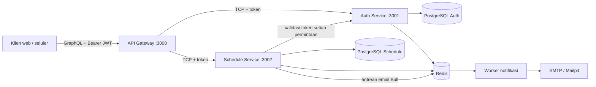

# Sistem Jadwal Layanan Kesehatan

Backend berbasis microservice untuk pengelolaan janji temu layanan kesehatan. API Gateway menyediakan GraphQL, sedangkan Auth Service dan Schedule Service berkomunikasi melalui TCP NestJS. Setiap service menggunakan database PostgreSQL masing-masing. Redis digunakan untuk pembatasan percobaan login, cache kueri jadwal, antrean email Bull, dan pengingat dalam aplikasi.

## Arsitektur



Gateway mengambil token dari header `Authorization: Bearer <token>` lalu meneruskannya pada setiap perintah RPC ke Schedule Service. Sebelum menjalankan operasi, Schedule Service meminta Auth Service memvalidasi token tersebut. Token yang tidak valid atau tidak disertakan akan ditolak dengan status Unauthorized. Redis menyimpan hasil kueri sementara, penghitung pembatasan permintaan, antrean email Bull, dan waktu pengingat. Pengingat juga disimpan di PostgreSQL Schedule agar dapat dipulihkan jika Redis tidak tersedia.

## Menjalankan dengan Docker Compose

Persyaratan: Docker dengan Compose serta Node.js 20+ dan Yarn.

1. Salin `.env.example` menjadi `.env`. Ganti kata sandi database/Redis dan `JWT_SECRET` contoh dengan nilai untuk lingkungan Anda. Jika kredensial Redis mengandung karakter khusus, enkode nilainya untuk URL.
2. Jalankan container:

   ```bash
   docker compose up --build -d
   ```

3. Pasang dependensi dan terapkan migrasi Prisma dari komputer host:

   ```bash
   yarn install
   yarn db:deploy:auth
   yarn db:deploy:schedule
   yarn seed:demo-admin
   ```

   Perintah seed membuat atau memperbarui akun admin lokal untuk uji teknis. Masuk menggunakan `admin@rata.test` / `RataDemo!2026`. Perintah ini menolak database yang host-nya bukan localhost.

4. Buka GraphQL Playground di <http://localhost:3000/graphql>. Dalam konfigurasi ini, Playground dan introspeksi skema aktif. Untuk operasi yang memerlukan autentikasi, isi panel `Headers`:

   ```json
   { "Authorization": "Bearer <access-token>" }
   ```

Email untuk pengembangan lokal dapat dilihat di Mailpit pada <http://localhost:8025>. Untuk memakai penyedia email sungguhan, atur `SMTP_HOST`, `SMTP_PORT`, `SMTP_SECURE`, `SMTP_USER`, `SMTP_PASSWORD`, dan `SMTP_FROM` di `.env`, lalu mulai ulang worker notifikasi. Periksa status container dan log dengan `docker compose ps` serta `docker compose logs -f auth-service schedule-service notification-service`.

## Variabel lingkungan

| Variabel | Kegunaan |
| --- | --- |
| `NODE_ENV` | Mode aplikasi. Service Compose berjalan dalam mode production. |
| `GRAPHQL_PLAYGROUND_ENABLED` | Mengaktifkan Playground pada gateway Compose (default `true` untuk konfigurasi lokal ini). Nonaktifkan untuk deployment production. |
| `API_GATEWAY_PORT`, `API_GATEWAY_HOST_PORT` | Port gateway di dalam container dan port yang dibuka di host. |
| `AUTH_SERVICE_PORT`, `AUTH_SERVICE_HOST` | Port TCP Auth dan alamat opsional untuk pengembangan dari host. Compose menggunakan DNS service. |
| `SCHEDULE_SERVICE_PORT`, `SCHEDULE_SERVICE_HOST` | Port TCP Schedule dan alamat opsional untuk pengembangan dari host. Compose menggunakan DNS service. |
| `AUTH_DB_USER`, `AUTH_DB_PASSWORD`, `AUTH_DB_NAME`, `AUTH_DB_HOST_PORT` | Kredensial, nama database PostgreSQL Auth, dan port yang dibuka di host. |
| `AUTH_DATABASE_URL`, `AUTH_DATABASE_URL_LOCAL` | URL Prisma Auth untuk Docker dan pengembangan dari host. |
| `SCHEDULE_DB_USER`, `SCHEDULE_DB_PASSWORD`, `SCHEDULE_DB_NAME`, `SCHEDULE_DB_HOST_PORT` | Kredensial, nama database PostgreSQL Schedule, dan port yang dibuka di host. |
| `SCHEDULE_DATABASE_URL`, `SCHEDULE_DATABASE_URL_LOCAL` | URL Prisma Schedule untuk Docker dan pengembangan dari host. |
| `JWT_SECRET` | Kunci rahasia untuk menandatangani dan memvalidasi access token. Gunakan nilai yang kuat dan privat. |
| `REDIS_PASSWORD`, `REDIS_HOST_PORT` | Kata sandi Redis dan port yang dibuka di host. |
| `REDIS_URL`, `REDIS_URL_LOCAL` | URL Redis untuk container dan pengembangan dari host. |
| `AUTH_LOGIN_RATE_LIMIT`, `AUTH_LOGIN_RATE_WINDOW_SECONDS` | Jumlah percobaan login per email yang dinormalisasi dan jangka waktunya (default: 5 kali per 900 detik). |
| `AUTH_REGISTER_RATE_LIMIT`, `AUTH_REGISTER_RATE_WINDOW_SECONDS` | Jumlah percobaan registrasi per email yang dinormalisasi dan jangka waktunya (default: 10 kali per 3600 detik). |
| `QUERY_CACHE_TTL_SECONDS` | Lama cache kueri Schedule (default: 30 detik). |
| `SMTP_HOST`, `SMTP_HOST_LOCAL`, `SMTP_PORT`, `SMTP_SECURE`, `SMTP_USER`, `SMTP_PASSWORD`, `SMTP_FROM` | Pengaturan pengiriman email. Default mengarah ke Mailpit untuk pengembangan lokal. |
| `MAILPIT_WEB_PORT` | Port antarmuka web Mailpit (default: 8025). |
| `OBSERVE_APP_KEY`, `OBSERVE_APP_SECRET` | Kredensial opsional NestJS Observe untuk telemetri service. |

Nilai pada `.env.example` hanya untuk pengembangan lokal. Jika Nest dijalankan langsung dari host, gunakan URL database dan Redis `*_LOCAL` jika tersedia. Compose menggunakan URL untuk container.

## Contoh GraphQL

Semua operasi tersedia di panel Docs pada Playground. Registrasi dan login tidak memerlukan token:

```graphql
mutation Register {
  register(
    email: "customer@example.com"
    password: "StrongPass123"
    name: "Amani"
  ) {
    id
    email
    name
  }
}
```

```graphql
mutation Login {
  login(email: "customer@example.com", password: "StrongPass123") {
    accessToken
    tokenType
    expiresIn
    user {
      id
      email
      name
    }
  }
}
```

Salin `accessToken` ke header `Authorization` seperti contoh sebelumnya. Schedule Service memvalidasi token melalui Auth Service pada setiap operasi.

```graphql
mutation BookAppointment {
  createSchedule(
    objective: "Konsultasi"
    doctorId: "<doctor-uuid>"
    scheduledAt: "2026-11-05T09:00:00.000Z"
  ) {
    id
    status
    scheduledAt
    doctor {
      id
      name
    }
    customer {
      id
      name
      email
    }
  }
}
```

Pelanggan dan dokter harus sudah terdaftar, dan waktu yang dipilih harus sesuai dengan ketersediaan dokter. Pemesanan akan memasukkan email konfirmasi ke antrean dan membuat pengingat dalam aplikasi untuk 24 jam dan 1 jam sebelum janji temu.

```graphql
query MyNotifications {
  notifications(page: 1, limit: 20) {
    items {
      id
      title
      message
      readAt
      createdAt
    }
    page
    total
  }
}
```

Admin klinik juga dapat mengelola urutan tahapan workflow. Tahapan disimpan di database Schedule untuk setiap akun admin; saat disimpan, seluruh daftar tahapan akan diganti sesuai urutan baru.

Profil pelanggan memiliki kolom opsional untuk telepon, jenis kelamin, tanggal lahir, alamat, perawatan, status perawatan, kunjungan berikutnya, dan catatan. Terapkan migrasi database Schedule sebelum memakai kolom profil tersebut:

```sh
yarn db:deploy:schedule
```

Admin dapat membuat, memperbarui, dan menghapus data pelanggan serta dokter. Akun dokter dapat ditautkan menggunakan `userId`. Admin dan dokter yang tertaut dapat mengatur ketersediaan mingguan. `doctorAvailabilities(doctorId)` menampilkan jadwal yang telah diatur (UTC), sedangkan `availableSlots(doctorId, date)` menampilkan slot mendatang yang belum dipesan untuk tanggal UTC tersebut.

```graphql
query WorkflowSteps {
  workflowSteps {
    id
    title
    description
    position
  }
}
```

```graphql
mutation SaveWorkflow {
  saveWorkflowSteps(
    steps: [
      { title: "Registrasi", description: "Verifikasi data pasien" }
      { title: "Pemeriksaan", description: "Pemeriksaan oleh dokter" }
    ]
  ) {
    id
    title
    description
    position
  }
}
```

```graphql
mutation MarkNotificationRead {
  markNotificationRead(id: "<notification-uuid>")
}
```

```graphql
mutation DeleteSchedule {
  deleteSchedule(id: "<schedule-uuid>")
}
```

Penghapusan janji temu hanya dapat dilakukan admin dan akan memasukkan email pemberitahuan untuk pelanggan ke antrean. Operasi lain yang tersedia antara lain `customers`, `customer`, `doctors`, `doctor`, `schedules`, `schedule`, `availableSlots`, `setDoctorAvailability`, `updateScheduleStatus`, dan `reschedule`. Buka panel Docs pada Playground untuk melihat argumen dan keterangan role setiap operasi.

## Role dan aturan janji temu

- Registrasi membuat akun dengan role `CUSTOMER`. Untuk uji teknis lokal, jalankan `yarn seed:demo-admin` setelah migrasi diterapkan agar akun admin siap digunakan.
- Admin dapat menetapkan role melalui `setUserRole`. Ubah role akun dokter menjadi `DOCTOR` sebelum menautkannya ke profil dokter.
- Dokter atau admin dapat mengatur ketersediaan mingguan melalui `setDoctorAvailability`. `dayOfWeek` bernilai `0` untuk Minggu hingga `6` untuk Sabtu. Jam dan waktu janji temu menggunakan UTC. Durasi slot harus 5–240 menit dan membagi rentang waktu secara merata.
- `availableSlots(doctorId, date)` menampilkan slot mendatang yang tersedia. Batasan database mencegah janji temu bertumpang tindih, termasuk saat pemesanan berlangsung bersamaan.
- Pelanggan dapat memesan dan melihat janji temunya sendiri, membatalkan dengan pemberitahuan minimal 24 jam sebelumnya, serta menjadwal ulang janji temu berstatus `REQUESTED`. Dokter dapat melihat janji temunya sendiri serta mengonfirmasi, membatalkan, atau menyelesaikannya. Admin dapat mengelola direktori dan menghapus janji temu.
- Alur status janji temu: `REQUESTED` → `CONFIRMED` → `COMPLETED`. Janji temu yang masih aktif dapat dibatalkan.
- Operasi GraphQL `notifications` dan `markNotificationRead` menyediakan backend untuk antarmuka notifikasi frontend. Frontend perlu mengambil atau memeriksa notifikasi secara berkala dan menandai notifikasi yang telah dibaca. Repositori ini hanya berisi backend.

## Kompilasi, migrasi, dan cakupan pengujian

```bash
yarn build
yarn build:auth
yarn build:schedule
yarn build:notification
yarn test
yarn test:cov
```

Ambang cakupan pengujian untuk aplikasi dan modul inti bersama ditetapkan sebesar 50%. Terapkan migrasi pengembangan dengan `yarn db:migrate:auth` dan `yarn db:migrate:schedule`. Untuk lingkungan deployment, gunakan `yarn db:deploy:auth` dan `yarn db:deploy:schedule`.
